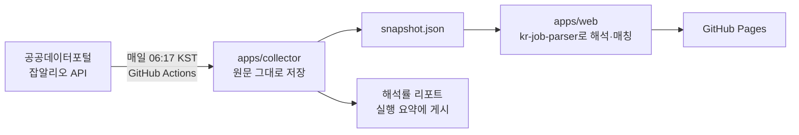

# Job Alert Hub

[](https://github.com/coddddin/job-alert-hub/actions/workflows/ci.yml) [](https://github.com/coddddin/job-alert-hub/actions/workflows/collect.yml) [](https://www.npmjs.com/package/kr-job-parser)

**채용공고마다 제각각인 경력·근무지·마감 표기를 해석해, 신입이 지금 지원할 수 있는 공고만 골라 보여주는 프로젝트입니다.**

지금은 공공데이터포털에서 진행 중인 공공기관 채용공고(약 500건)를 매일 아침 모아 해석하고 [GitHub Pages](https://coddddin.github.io/job-alert-hub/)에 배포합니다. 표기를 해석하는 부분은 [`kr-job-parser`](packages/kr-job-parser)라는 라이브러리·CLI로 분리해 [npm에 배포](https://www.npmjs.com/package/kr-job-parser)했습니다.

**[실제 화면](https://coddddin.github.io/job-alert-hub/)** · [kr-job-parser](packages/kr-job-parser) · [실데이터가 찾아낸 것](#실데이터가-찾아낸-것) · [검증과 자동화](#검증과-자동화) · [트러블슈팅](docs/TROUBLESHOOTING.md) · [시작하기](#시작하기)


## 무엇을 해결하나요?

"서울에서 일할 수 있는 신입 개발 공고"만 보고 싶어도, 공고마다 같은 뜻이 다르게 적혀 있어 문자열 비교로는 걸러낼 수 없습니다.

| 의미 | 표기 예시 |
| --- | --- |
| 경력 3년 이상 | `경력 3년↑`, `경력3년 이상`, `3년차 이상` |
| 서울 근무 | `서울`, `서울특별시 강남구`, `서울,경기` |
| 광주 또는 전남 근무 | `전남광주` (2026년 7월 출범한 통합특별시) |
| 11월 17일 마감 | `~11/17(화)`, `2026.11.17`, `20261117`, `D-14` |

그래서 표기 해석을 라이브러리로 분리하고, 해석하지 못한 항목은 버리지 않고 "확인 필요"로 남기는 구조로 만들었습니다.

## 구성



| 패키지 | 역할 |
| --- | --- |
| [`packages/kr-job-parser`](packages/kr-job-parser) | 경력·근무지·마감 표기를 타입이 있는 데이터로 바꾸는 라이브러리와 CLI. 런타임 의존성 0개, npm 배포. |
| [`apps/collector`](apps/collector) | 수집처별 어댑터로 공고를 모아 **원문 그대로** 저장하고 해석률 리포트를 냅니다. 외부 응답은 런타임에 검증합니다. |
| [`apps/web`](apps/web) | 저장된 원문을 브라우저에서 `kr-job-parser`로 해석해 목록과 공고 상세를 보여줍니다. |

수집기는 해석하지 않고 원문만 저장합니다. 해석은 화면을 그릴 때 하므로, 파서 규칙을 고치면 다시 수집하지 않아도 결과가 바뀝니다.

## 실데이터가 찾아낸 것

가상 공고 12건으로 만든 파서를 실제 공고 519건(2026-11-03 수집)에 처음 돌렸을 때의 결과입니다.

| 필드 | 보강 전 | 보강 후 | 원인 |
| --- | ---: | ---: | --- |
| 경력 | 519 / 519 | 519 / 519 | |
| 근무지 | 466 / 519 | 517 / 519 | `전남광주`: 2026년 7월 출범한 통합특별시를 모르는 상태였음 |
| 마감 | **0** / 519 | 519 / 519 | `20261117`: 구분자 없는 날짜 형식을 지원하지 않았음 |
| **해석률** | **63.3%** | **99.9%** | |

- 남은 2건은 근무지가 `해외`인 공고로, 시·도가 아니므로 "확인 필요"로 남기는 것이 의도한 동작입니다.
- `전남광주`를 새 시·도로 추가하지 않고 `광주`·`전남` 두 곳으로 해석했습니다. 사용자가 저장해 둔 `광주` 필터가 계속 맞게 하기 위해서입니다.
- 두 표기는 실제 값 그대로 테스트 케이스로 고정했습니다 ([kr-job-parser 0.3.0](packages/kr-job-parser/CHANGELOG.md)).

> **해석률은 정확도가 아닙니다.** "해석하지 못함(`unknown`)이 아닌 비율"이라서, 틀리게 해석한 경우도 해석된 것으로 셉니다. 정답을 직접 단 공고 표본으로 정확도를 재는 일은 [다음 단계](#알려진-한계와-다음-단계)입니다. 이 차이는 [트러블슈팅](docs/TROUBLESHOOTING.md) 문서에도 적었습니다.

매일 수집할 때마다 필드별 해석률과 *해석하지 못한 원문 상위 10개*를 Actions 실행 요약에 남깁니다. 다음에 추가할 규칙은 이 목록에서 고릅니다.

## 화면

| 공고 상세: 지원 조건과 지원하기 버튼 | 모바일 |
| --- | --- |
|  |  |

- 사용자에게는 해석한 값만 보여줍니다. 원문 표기는 해석하지 못한 항목에만 "확인 필요"와 함께 나타납니다.
- 공고 상세에는 채용 인원, 최소 학력(분야별 학력), 고용 형태, 우대 조건, 지원 자격 원문을 정리하고, 하단에 고정된 버튼으로 잡알리오 공고 상세(공고문·접수 안내)로 이동합니다.
- 주소에 `?raw`를 붙이면 개발용으로 모든 원문을 함께 볼 수 있습니다.


## 검증과 자동화

외부 데이터에 기대는 코드를 안전하게 바꾸기 위해, 사람이 매번 확인하지 않아도 되는 장치를 먼저 두었습니다.

| 단계 | 하는 일 | 위치 |
| --- | --- | --- |
| CI | Node 22·24에서 빌드 → 린트 → 타입 검사 → 테스트 → 커버리지 기준 → 패키지 검사 | [ci.yml](.github/workflows/ci.yml) |
| 타입 | `strict`, `noUncheckedIndexedAccess`, `exactOptionalPropertyTypes`, typescript-eslint `strictTypeChecked` | [tsconfig](packages/kr-job-parser/tsconfig.json) |
| 테스트 | 표 형식 테스트와 타입 테스트(파서 229, 수집기 49, 웹 18). 실제 API 응답을 fixture로 사용 | [test/](packages/kr-job-parser/test) |
| 패키지 검사 | publint·attw로 설정을 보고, **실제 tarball을 빈 프로젝트에 설치해** import와 `npx` 실행까지 확인 | [smoke-pack.mjs](packages/kr-job-parser/scripts/smoke-pack.mjs) |
| 배포 | 버전을 올려 머지하면 npm **Trusted Publishing**(저장된 토큰 없음)으로 배포하고 provenance 서명, 태그, GitHub Release를 만듦 | [release.yml](.github/workflows/release.yml) |
| 매일 수집 | 수집 → 해석률 리포트 → 정적 사이트 빌드 → Pages 배포. 수집이 실패하면 배포하지 않아 마지막 정상 화면이 남음 | [collect.yml](.github/workflows/collect.yml) |
| 데이터 회귀 검사 | `kr-job-parser <필드> --strict`에 원문 목록을 넘기면 해석 실패가 있을 때 종료 코드 1 | [CLI](packages/kr-job-parser#cli) |

## 개발 방식

이 저장소의 코드는 AI 코딩 도구(Claude)와 함께 작성했습니다. 커밋의 `Co-Authored-By`가 그 기록입니다.

AI가 쓴 코드는 그럴듯해 보여도 틀릴 수 있어서, 위의 검증 장치를 먼저 세우고 그 안에서 작업했습니다. 엄격한 타입, 표 형식 테스트, 깨끗한 환경에서 도는 CI, 실데이터 해석률 리포트입니다. [트러블슈팅](docs/TROUBLESHOOTING.md)에 적은 문제들은 이 장치들이 잡아낸 것입니다. 무엇을 만들지, 어떤 수집처를 쓸지, 화면에서 무엇을 보여줄지는 직접 정하고 검토했습니다.

## 수집처를 고른 기준

| 대상 | 결과 | 이유 |
| --- | --- | --- |
| 공공데이터포털 · 잡알리오 | **연동** | 개인 신청 자동 승인, JSON, 이용 범위 제한 없음 |
| 잡코리아 | 보류 | 공공기관·학교 대상 서비스이고 서버 IP 등록이 필요해 GitHub Actions와 맞지 않음 |
| 원티드 | 보류 | 사업자등록번호가 있어야 신청 가능 |
| 사람인 · 고용24 | 검토 중 | 별도 심사 필요 |

크롤링은 각 사이트 약관에 어긋나므로 쓰지 않습니다. 새 수집처는 [`Provider` 인터페이스](apps/collector/src/providers/provider.ts)만 구현하면 파서와 웹 코드를 바꾸지 않고 추가할 수 있습니다.

## 시작하기

**준비물: Node.js 22 이상, Git, [pnpm](https://pnpm.io).** API 키가 없으면 가상 공고 12건으로 동작합니다.

```sh
git clone https://github.com/coddddin/job-alert-hub.git
cd job-alert-hub
pnpm install
pnpm build                                  # 웹이 쓰는 kr-job-parser를 빌드
pnpm --filter @job-alert-hub/web start      # http://127.0.0.1:3000
```

실제 공고로 보려면 [공공데이터포털](https://www.data.go.kr/data/15125273/openapi.do)에서 발급받은 인증키로 먼저 수집합니다. 결과(`apps/web/data/live/`)가 있으면 웹이 실데이터를 쓰고, 없으면 샘플로 돌아갑니다(`?sample`로 샘플 강제).

```sh
DATA_GO_KR_KEY=발급받은_일반_인증키 pnpm --filter @job-alert-hub/collector collect
```

라이브러리만 써 보려면 설치 없이 실행할 수 있습니다.

```sh
npx kr-job-parser loc "전남광주통합특별시 광산구"   # ✓ … → 광주 광산구
```

전체 검증은 저장소 루트에서 한 번에 실행합니다.

```sh
pnpm check   # build → lint → typecheck → test → 패키지 검사
```

## 알려진 한계와 다음 단계

- **정확도를 재지 않았습니다.** 위의 해석률은 커버리지입니다. 정답을 직접 단 공고 표본으로 정확도를 재는 것이 다음 작업입니다.
- **공공기관 공고로만 검증했습니다.** 공공 API는 필드가 정형화되어 있어, 민간 채용 사이트의 자유로운 표기는 충분히 검증하지 못했습니다.
- **웹은 타입 검사를 하지 않습니다.** `packages`와 `apps/collector`는 엄격한 TypeScript지만 `apps/web`은 JavaScript입니다.
- **알림을 실제로 보내지 않습니다.** 알림 조건 설정과 미리보기만 있습니다. 로그인 없이 내 메일로 새 공고를 보내는 것부터 붙일 예정입니다.
- 공공기관 공고 대부분은 개발 직무가 아니어서, 기본 화면에서는 NCS 분류에 `정보통신`이 있는 공고만 맞춤으로 남깁니다.
- 설정과 스크랩은 브라우저 저장소에만 보관되며 기기 간 동기화하지 않습니다.

상세 정책은 [설계 문서](docs/PROJECT_DESIGN.md)를 참고하세요.

## 기여하기

이슈에 **원하는 동작과 구체적인 예시**를 남겨 주세요. 해석하지 못하는 표기를 발견했다면 원문 그대로 적어 주시면 테스트 케이스로 추가합니다. 자세한 절차는 [CONTRIBUTING.md](CONTRIBUTING.md)를 참고하세요. 계정 토큰·API 키·개인 이메일은 공개 이슈에 올리지 마세요.

## 라이선스

[`packages/kr-job-parser`](packages/kr-job-parser)는 [MIT](packages/kr-job-parser/LICENSE)입니다. 저장소의 나머지 부분은 라이선스를 아직 정하지 않았습니다.
