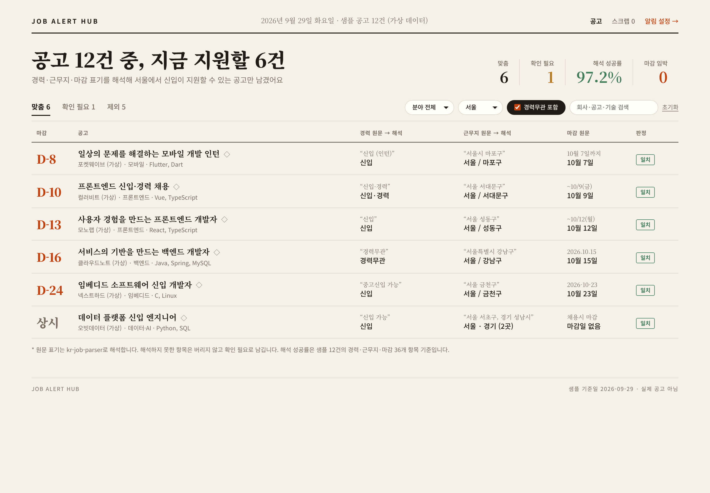
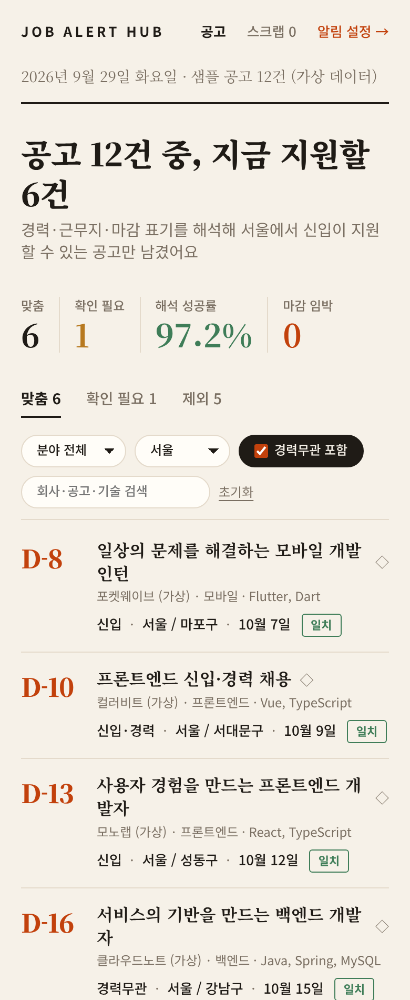
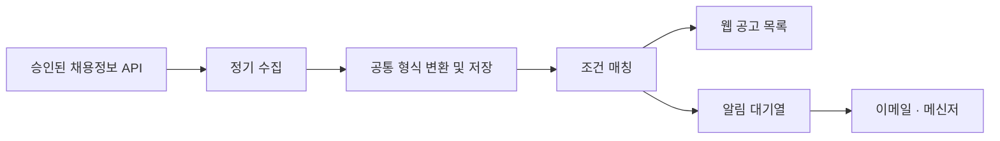

# Job Alert Hub · 채용공고 모아보기

**여러 채용 사이트의 공고를 한곳에서 보고, 내 조건에 맞는 새 공고를 알림으로 받는 프로젝트입니다.**

직무·경력·지역을 저장하면 관심 공고를 모아 보여주고, 이메일과 메신저로 알려주는 서비스를 만들고 있습니다. 개인용으로 시작해 여러 사용자가 사용할 수 있도록 확장할 예정입니다.

> **로컬 프로토타입 v0.1** — 가상 공고 12건으로 목록 필터, 스크랩, 지원 상태, 독립된 알림 설정을 체험할 수 있습니다. 실제 공고 수집·로그인·이메일 및 카카오톡 발송은 아직 연결하지 않았습니다.

[사용 예시](#사용-예시) · [주요 기능](#주요-기능) · [시작하기](#시작하기) · [로드맵](#로드맵) · [기여하기](CONTRIBUTING.md)

<details>
<summary>샘플 화면 보기</summary>



</details>

## 왜 만드나요?

같은 조건으로 여러 채용 사이트를 반복해서 검색하는 일을 줄이고 싶었습니다. 공고를 넓게 살펴보면서도, 알림은 꼭 필요한 조건만 골라 받을 수 있도록 설계합니다.

## 사용 예시

**“서울에서 일할 신입 개발자 공고를 찾고 있어요.”**

1. 목록 조건을 `개발자 / 신입 / 서울`로 저장합니다.
2. 신입 지원 가능 공고와 경력무관 공고를 구분해서 살펴봅니다.
3. 알림에서는 관심 개발 분야와 경력 유형을 더 좁게 선택합니다.
4. 새 공고를 묶음 알림으로 받고, 마음에 드는 공고는 원문에서 지원합니다.

아래는 동작을 설명하기 위한 **가상 공고**입니다.

| 공고 | 목록 | 기본 알림 |
| --- | --- | --- |
| 서울 마포 · 프론트엔드 · 신입 | 표시 | 포함 |
| 서울 강남 · 백엔드 · 경력무관 | 별도 표시 | 제외, 설정으로 변경 가능 |
| 서울 구로 · 서버 개발 · 경력 3년 필수 | 제외 | 제외 |
| 경기 성남 · 앱 개발 · 신입 | 제외 | 제외 |

## 주요 기능

현재 구현한 기능은 가상 데이터로만 동작합니다.

| 기능 | 현재 상태 |
| --- | --- |
| 공고 목록·상세 | 샘플 12건, 조건 일치 및 확인 필요 분리 |
| 맞춤 필터 | 개발 분야·근무지·경력무관 포함 여부·키워드 구현 |
| 독립된 알림 조건 | 조건·채널 선호·빈도 저장과 미리보기 구현, 실제 발송 없음 |
| 스크랩·지원 관리 | 브라우저 저장소에 스크랩과 지원 상태 저장 |
| 지원 요건 표시 | 샘플 공고의 원문 표기(경력·근무지·마감)를 [kr-job-parser](packages/kr-job-parser)로 해석해 판정. 공고 상세에서 원문과 해석 결과를 함께 표시. 관심도 점수는 예정 |
| 실데이터·이메일·메신저 | 연동 예정 |
| 유사 공고·관심 없음 | 구현 예정 |
| 마감·변경 알림 | 구현 예정 |

## 연동 계획과 제한

| 대상 | 계획 | 현재 상태 |
| --- | --- | --- |
| 사람인 | 첫 채용정보 API 연동 후보 | 승인·키 확보 및 실연동 검증 전 |
| 잡코리아 | 추가 채용정보 API 연동 | 제공 가능 여부 심사 및 실연동 검증 전 |
| 고용24 | 이용 자격 확인 후 검토 | 검토 단계 |
| 이메일 | 확인된 수신 주소로 발송 | 미구현 |
| 카카오톡 | 개인용 ‘나에게 보내기’ 우선 시험 | 실기기 알림 검증 전 |

- 수집 가능한 공고 범위와 갱신 속도는 사이트별로 다릅니다. 모든 공고 수집이나 게시 즉시 알림을 보장하지 않습니다.
- 카카오톡 메시지 전송 성공과 휴대폰 배너·소리 발생은 구분해서 검증합니다.
- Gmail 주소로 알림을 받는 기능은 메일함 읽기 권한을 요구하지 않는 구조로 설계합니다.
- 지원은 원문 채용 사이트에서 진행합니다.

공급자별 공식 자료와 상세 조건은 [설계 문서](docs/PROJECT_DESIGN.md)에 정리했습니다.

## 시작하기

**준비물: Node.js 22 이상, Git, [pnpm](https://pnpm.io).** API 키는 필요하지 않습니다.

```sh
git clone https://github.com/coddddin/job-alert-hub.git
cd job-alert-hub
pnpm install
pnpm build                                  # 웹이 쓰는 kr-job-parser를 빌드
pnpm --filter @job-alert-hub/web start
```

브라우저에서 **http://127.0.0.1:3000** 을 엽니다. 종료는 터미널에서 `Ctrl+C`를 누릅니다. 3000번 포트가 사용 중이면 Windows PowerShell에서 `$env:PORT=3001`을 설정한 뒤 다시 실행하세요.

전체 검증은 저장소 루트에서 한 번에 실행합니다.

```sh
pnpm check   # lint → typecheck → build → test → 패키지 설정 검사
```

- 설정과 스크랩은 이 브라우저의 로컬 저장소에만 보관되며 기기 간 동기화하지 않습니다.
- 가상 공고에는 원문 지원 링크가 없습니다. 날짜도 고정된 샘플 값입니다.
- 알림 채널과 빈도는 설정 미리보기이며 자동 발송을 켜는 기능이 아닙니다.
- 서버는 이 PC의 `127.0.0.1`에만 열립니다. 휴대폰 실기기 접속과 공개 배포는 아직 지원하지 않습니다.

상세 정책은 [설계 문서](docs/PROJECT_DESIGN.md), 검증 범위는 [프로토타입 기록](docs/PROTOTYPE.md)을 참고하세요.

## 저장소 구조

pnpm 워크스페이스로 구성된 모노레포입니다.

```
job-alert-hub/
├─ apps/
│  └─ web/              # 공고 목록·알림 설정 웹 프로토타입
└─ packages/
   └─ kr-job-parser/    # 채용공고 표기 해석 라이브러리 (npm 배포 대상)
```

| 패키지 | 설명 |
| --- | --- |
| [`apps/web`](apps/web) | 가상 공고로 동작하는 로컬 프로토타입입니다. 공고의 원문 표기를 `kr-job-parser`로 해석해 목록·알림 조건에 씁니다. |
| [`packages/kr-job-parser`](packages/kr-job-parser) | `경력 3년↑`, `서울 외 2곳`, `~11/14(금)` 같은 제각각인 경력·근무지·마감 표기를 타입이 있는 데이터로 바꿉니다. 실연동 시 "공통 형식 변환" 단계를 맡습니다. |

웹은 브라우저에서 파서를 직접 불러옵니다. 서버가 빌드된 파일을 `/vendor/kr-job-parser/`로 제공하고, 페이지의 import map이 `kr-job-parser`를 그 경로로 연결합니다. 인라인 import map은 CSP에 해시로만 허용해 `unsafe-inline` 없이 동작합니다.

공고 목록은 한 줄에 공고 하나씩, 경력·근무지·마감의 **원문 표기와 해석 결과를 나란히** 보여줍니다. 해석하지 못한 항목이 있는 공고는 버리지 않고 "확인 필요" 탭으로 보내고, 제외된 공고는 제외 사유와 함께 따로 볼 수 있습니다.

| 공고 상세: 원문 → 해석 | 확인 필요: 해석 불가 항목 강조 |
| --- | --- |
|  |  |

좁은 화면에서는 원문 열을 접고 해석 결과만 한 줄로 보여줍니다.



## 개발 구조

실데이터 연결 이후의 **예정 구조**입니다. 현재는 Node.js 정적 서버와 브라우저 JavaScript로 구동하며 필터 로직을 별도 모듈로 분리했습니다. Next.js·TypeScript 전환은 후속 작업입니다.



| 역할 | 기술 후보 |
| --- | --- |
| 웹 화면 | Next.js · TypeScript |
| 데이터 저장·로그인 | PostgreSQL · Supabase · Google 로그인 |
| 수집·알림 처리 | 별도 Node.js 작업자 |
| 이메일 | Resend 후보 |
| 메신저 | 카카오톡 공식 API 우선 검증 |

기술 선택은 실연동 검증 결과에 따라 조정합니다.

## 로드맵

- [x] 개인용 우선 범위와 검색·알림 정책 설계
- [x] GitHub용 소개·기여·변경 요청 문서 준비
- [ ] 채용정보 API 이용 가능 여부와 실제 응답 확인
- [ ] 카카오톡 연결 및 실제 휴대폰 수신 시험
- [x] 샘플 공고로 필터 정확도 검증
- [x] 샘플 목록·알림 설정·스크랩·지원 상태 구현
- [x] 공고 표기 해석 라이브러리 분리 (`kr-job-parser`: 경력·근무지·마감)
- [x] 웹에 파서 연결 (샘플 공고를 원문 표기로 바꾸고 파서로 해석)
- [ ] 실제 계정과 데이터베이스 연결
- [ ] 실제 수집과 이메일·메신저 알림 연결
- [ ] 운영 환경 배포와 오류 복구 검증

외부 API 승인 대기 중에도 샘플 데이터 기반 개발은 진행합니다.

## 기여하기

개발 경험이 없어도 검색 결과 개선 의견이나 사용 시나리오를 제안할 수 있습니다. 이슈에 **원하는 동작과 구체적인 예시**를 남겨 주세요. 코드 변경은 작은 단위의 Pull Request로 진행합니다.

자세한 절차는 [CONTRIBUTING.md](CONTRIBUTING.md)를 참고하세요. 계정 토큰·API 키·개인 이메일·이력서는 공개 이슈에 올리지 마세요.

## 라이선스

라이선스는 아직 결정하지 않았습니다. 재사용·배포 조건은 라이선스 확정 후 명시합니다.

## README 구성 참고

아래 자료의 소개·사용 예시·시작 안내·기여 안내 구성을 참고했습니다. 코드나 본문을 복사한 것은 아닙니다.

- [GitHub: README 작성 안내](https://docs.github.com/en/repositories/managing-your-repositorys-settings-and-features/customizing-your-repository/about-readmes)
- [changedetection.io](https://github.com/dgtlmoon/changedetection.io): 문제 설명과 사용 사례 구성
- [Apprise](https://github.com/caronc/apprise): 알림 프로젝트의 기능·개발 안내 구성
