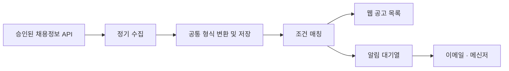

# Job Alert Hub · 채용공고 모아보기

**여러 채용 사이트의 공고를 한곳에서 보고, 내 조건에 맞는 새 공고를 알림으로 받는 프로젝트입니다.**

직무·경력·지역을 저장하면 관심 공고를 모아 보여주고, 이메일과 메신저로 알려주는 서비스를 만들고 있습니다. 개인용으로 시작해 여러 사용자가 사용할 수 있도록 확장할 예정입니다.

> **현재는 설계 단계입니다.** 실행 가능한 앱, 데모, 실제 공고 수집 및 알림 발송은 아직 제공하지 않습니다. 아래 기능은 구현 계획이며, 사이트 연동은 제공업체의 승인과 이용 조건에 따라 달라집니다.

[사용 예시](#사용-예시) · [주요 기능](#주요-기능) · [시작하기](#시작하기) · [로드맵](#로드맵) · [기여하기](CONTRIBUTING.md)

## 왜 만드나요?

같은 조건으로 여러 채용 사이트를 반복해서 검색하는 일을 줄이고 싶었습니다. 공고를 넓게 살펴보면서도, 알림은 꼭 필요한 조건만 골라 받을 수 있도록 설계합니다.

## 사용 예시

**“서울에서 일할 신입 개발자 공고를 찾고 있어요.”**

1. 목록 조건을 `개발자 / 신입 / 서울`로 저장합니다.
2. 신입 지원 가능 공고와 경력무관 공고를 구분해서 살펴봅니다.
3. 알림에서는 관심 개발 분야와 경력 유형을 더 좁게 선택합니다.
4. 새 공고를 묶음 알림으로 받고, 마음에 드는 공고는 원문에서 지원합니다.

아래는 동작을 설명하기 위한 **가상 공고**입니다.

| 공고 | 목록 | 기본 알림 |
| --- | --- | --- |
| 서울 마포 · 프론트엔드 · 신입 | 표시 | 포함 |
| 서울 강남 · 백엔드 · 경력무관 | 별도 표시 | 제외, 설정으로 변경 가능 |
| 서울 구로 · 서버 개발 · 경력 3년 필수 | 제외 | 제외 |
| 경기 성남 · 앱 개발 · 신입 | 제외 | 제외 |

## 주요 기능

모든 항목은 **구현 예정**입니다.

| 기능 | 사용자가 할 수 있는 일 |
| --- | --- |
| 통합 공고 목록 | 출처와 원문 링크를 유지하며 여러 사이트의 공고 보기 |
| 맞춤 필터 | 직무·지역·경력·키워드 등으로 검색하기 |
| 독립된 알림 조건 | 목록은 넓게 보고 알림은 필요한 공고만 받기 |
| 이메일·메신저 알림 | 새 공고를 묶어서 받기, 카카오톡 우선 검증 |
| 지원 요건 표시 | 신입 지원 여부와 관심 기술 일치 여부를 구분하기 |
| 유사 공고 보기 | 원본을 유지하며 비슷한 공고를 함께 보기 |
| 관심 없음·지원 관리 | 제외 사유를 기록하고 지원 진행 상황 관리하기 |
| 마감·변경 알림 | 스크랩 공고의 중요한 변화만 선택해서 받기 |

## 연동 계획과 제한

| 대상 | 계획 | 현재 상태 |
| --- | --- | --- |
| 사람인 | 첫 채용정보 API 연동 후보 | 승인·키 확보 및 실연동 검증 전 |
| 잡코리아 | 추가 채용정보 API 연동 | 제공 가능 여부 심사 및 실연동 검증 전 |
| 고용24 | 이용 자격 확인 후 검토 | 검토 단계 |
| 이메일 | 확인된 수신 주소로 발송 | 미구현 |
| 카카오톡 | 개인용 ‘나에게 보내기’ 우선 시험 | 실기기 알림 검증 전 |

- 수집 가능한 공고 범위와 갱신 속도는 사이트별로 다릅니다. 모든 공고 수집이나 게시 즉시 알림을 보장하지 않습니다.
- 카카오톡 메시지 전송 성공과 휴대폰 배너·소리 발생은 구분해서 검증합니다.
- Gmail 주소로 알림을 받는 기능은 메일함 읽기 권한을 요구하지 않는 구조로 설계합니다.
- 지원은 원문 채용 사이트에서 진행합니다.

공급자별 공식 자료와 상세 조건은 [설계 문서](docs/PROJECT_DESIGN.md)에 정리했습니다.

## 시작하기

현재 저장소에는 설계와 협업 문서만 있습니다. 설치하거나 실행할 앱은 아직 없습니다.

1. 이 README에서 프로젝트 범위와 현재 상태를 확인합니다.
2. [상세 설계](docs/PROJECT_DESIGN.md)에서 필터·수집·알림 정책을 확인합니다.
3. 개발 참여 또는 의견 제안은 [기여 안내](CONTRIBUTING.md)를 참고합니다.

실행 코드가 추가되면 실제 검증한 설치 명령, 환경변수 예제, 샘플 데이터 실행 방법을 이곳에 추가합니다.

## 개발 구조

다음은 **예정 구조**입니다.

| 역할 | 기술 후보 |
| --- | --- |
| 웹 화면 | Next.js · TypeScript |
| 데이터 저장·로그인 | PostgreSQL · Supabase · Google 로그인 |
| 수집·알림 처리 | 별도 Node.js 작업자 |
| 이메일 | Resend 후보 |
| 메신저 | 카카오톡 공식 API 우선 검증 |

기술 선택은 실연동 검증 결과에 따라 조정합니다.

## 로드맵

- [x] 개인용 우선 범위와 검색·알림 정책 설계
- [x] GitHub용 소개·기여·변경 요청 문서 준비
- [ ] 채용정보 API 이용 가능 여부와 실제 응답 확인
- [ ] 카카오톡 연결 및 실제 휴대폰 수신 시험
- [ ] 샘플 공고로 필터 정확도 검증
- [ ] 통합 목록·알림 설정·지원 관리 구현
- [ ] 실제 수집과 이메일·메신저 알림 연결
- [ ] 운영 환경 배포와 오류 복구 검증

외부 API 승인 대기 중에도 샘플 데이터 기반 개발은 진행합니다.

## 기여하기

개발 경험이 없어도 검색 결과 개선 의견이나 사용 시나리오를 제안할 수 있습니다. 이슈에 **원하는 동작과 구체적인 예시**를 남겨 주세요. 코드 변경은 작은 단위의 Pull Request로 진행합니다.

자세한 절차는 [CONTRIBUTING.md](CONTRIBUTING.md)를 참고하세요. 계정 토큰·API 키·개인 이메일·이력서는 공개 이슈에 올리지 마세요.

## 라이선스

라이선스는 아직 결정하지 않았습니다. 재사용·배포 조건은 라이선스 확정 후 명시합니다.

## README 구성 참고

아래 자료의 소개·사용 예시·시작 안내·기여 안내 구성을 참고했습니다. 코드나 본문을 복사한 것은 아닙니다.

- [GitHub: README 작성 안내](https://docs.github.com/en/repositories/managing-your-repositorys-settings-and-features/customizing-your-repository/about-readmes)
- [changedetection.io](https://github.com/dgtlmoon/changedetection.io): 문제 설명과 사용 사례 구성
- [Apprise](https://github.com/caronc/apprise): 알림 프로젝트의 기능·개발 안내 구성
