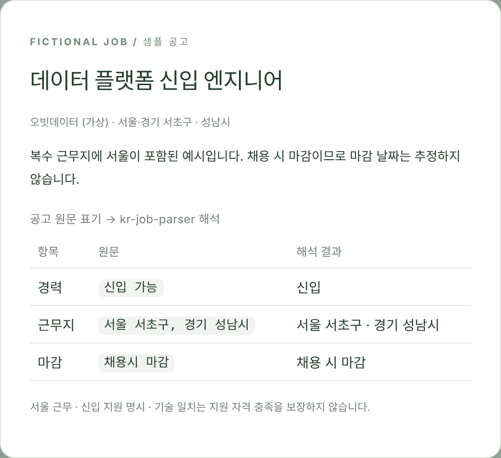

# kr-job-parser

**한국 채용공고의 제각각인 표기를 타입이 있는 구조화 데이터로 바꿉니다.**

```ts
import { parseExperience, parseLocation, parseDeadline } from 'kr-job-parser';

parseExperience('경력 3년↑');
// { kind: 'experienced', range: { min: { years: 3, inclusive: true } } }

parseLocation('서울 강남구 외 2곳 (재택 병행)');
// { places: [{ sido: '서울', sigungu: '강남구' }], nationwide: false, remote: 'partial', others: 2, unparsed: [] }

parseDeadline('~11/14(금)', { today: '2026-11-03' });
// { kind: 'date', date: '2026-11-14' }
```

경력 요건, 근무지, 마감일 세 가지를 해석하고, 각각에 대해 "이 지원자·지역·날짜에 맞는가"를 판단하는 함수를 함께 제공합니다.

## 왜 만들었나요?

[Job Alert Hub](../../README.md)에서 여러 채용 사이트의 공고를 모아 "신입이 지원할 수 있는 공고"만 알림으로 보내려고 했습니다. 그런데 같은 의미가 사이트마다, 공고마다 다르게 적혀 있었습니다.

| 의미 | 실제 표기 예시 |
| --- | --- |
| 경력 3년 이상 | `경력 3년 이상`, `경력3년↑`, `경력 3년+`, `3년차 이상`, `경력(3년 이상)` |
| 신입과 경력 모두 | `신입·경력`, `신입/경력`, `경력 1년 이상 (신입 가능)` |
| 서울 근무 | `서울`, `서울특별시`, `서울시 강남구`, `서울특별시 강남구 테헤란로 123` |
| 근무지가 더 있음 | `서울 외 2곳`, `부산 외 3개 지역`, `서울 외 다수` |
| 11월 14일 마감 | `~11/14(금)`, `2026.11.14`, `26.11.14`, `11월 14일까지`, `D-11` |
| 마감일 없음 | `상시채용`, `수시채용`, `채용시 마감`, `충원 시 마감` |

문자열 비교로는 이 차이를 감당할 수 없어서, 표기를 해석하는 부분을 서비스에서 분리해 독립된 라이브러리로 만들었습니다.

### 실제로 쓰이는 모습

Job Alert Hub 웹은 공고의 원문 표기를 이 라이브러리로 해석해 목록과 알림 조건을 판단합니다. 해석하지 못한 항목이 있는 공고는 버리지 않고 "확인 필요" 목록으로 보냅니다.



## 설치

```sh
pnpm add kr-job-parser
# npm install kr-job-parser
```

Node.js 22 이상, ESM 전용입니다. 런타임 의존성은 없습니다.

## 사용법

### 공고 하나를 판단하기

```ts
import {
  acceptsNewcomer,
  isOpen,
  matchesRegion,
  parseDeadline,
  parseExperience,
  parseLocation,
  type Fit,
} from 'kr-job-parser';

const today = '2026-11-03';

function canApply(posting: { experience: string; location: string; deadline: string }): Fit[] {
  return [
    acceptsNewcomer(parseExperience(posting.experience)),
    matchesRegion(parseLocation(posting.location), '서울'),
    isOpen(parseDeadline(posting.deadline, { today }), today),
  ];
}

canApply({ experience: '신입·경력', location: '서울 강남구', deadline: '~11/14' });
// ['yes', 'yes', 'yes']

canApply({ experience: '경력 3년 이상', location: '부산 외 2곳', deadline: '협의' });
// ['no', 'unknown', 'unknown']
```

판단 함수는 모두 `'yes' | 'no' | 'unknown'`을 돌려줍니다. 해석하지 못한 공고를 `false`로 처리하면 지원 가능한 공고를 조용히 놓치게 되므로, 사람이 확인할 수 있게 `unknown`으로 따로 둡니다.

### 결과 타입으로 분기하기

```ts
import { parseExperience, type Experience } from 'kr-job-parser';

function label(experience: Experience): string {
  switch (experience.kind) {
    case 'new':
      return '신입';
    case 'any':
      return '경력무관';
    case 'experienced':
    case 'new-or-experienced':
      return experience.range.min ? `${experience.range.min.years}년 이상` : '경력';
    case 'unknown':
      return `확인 필요: ${experience.raw}`;
  }
}
```

`Experience`와 `Deadline`은 `kind`로 구분되는 유니온 타입입니다. 새로운 `kind`가 추가되면 위와 같은 `switch`에서 처리하지 않은 경우를 컴파일러가 알려줍니다.

## API

### 경력 요건

| 함수 | 설명 |
| --- | --- |
| `parseExperience(raw: string): Experience` | 경력 표기를 해석합니다. 해석하지 못하면 `{ kind: 'unknown', raw }`를 돌려줍니다. |
| `fitsYears(experience, years: number): Fit` | `years`년 경력의 지원자가 요건에 맞는지 판단합니다. 신입은 1년 미만으로 봅니다. |
| `acceptsNewcomer(experience): Fit` | `fitsYears(experience, 0)`과 같습니다. |

```ts
type Experience =
  | { kind: 'new' }
  | { kind: 'experienced'; range: YearRange }
  | { kind: 'new-or-experienced'; range: YearRange }
  | { kind: 'any' }
  | { kind: 'unknown'; raw: string };

interface YearRange { min?: YearBound; max?: YearBound }
interface YearBound { years: number; inclusive: boolean } // 미만·초과는 inclusive: false
```

### 근무지

| 함수·상수 | 설명 |
| --- | --- |
| `parseLocation(raw: string): WorkLocation` | 근무지 표기를 해석합니다. 인식하지 못한 조각은 `unparsed`에 남깁니다. |
| `matchesRegion(location, sido: Sido): Fit` | 해당 시·도에서 일할 수 있는 공고인지 판단합니다. |
| `SIDO` | 시·도 17곳의 짧은 이름 배열입니다. `Sido` 타입은 이 배열에서 만들어집니다. |

```ts
type Sido = '서울' | '부산' | '대구' | '인천' | '광주' | '대전' | '울산' | '세종'
          | '경기' | '강원' | '충북' | '충남' | '전북' | '전남' | '경북' | '경남' | '제주';

interface WorkLocation {
  places: Place[];                 // 인식한 근무지 (중복 제거)
  nationwide: boolean;             // '전국' 표기
  remote: 'none' | 'partial' | 'full';
  others: number | 'unknown';      // '외 2곳' → 2, '외 다수' → 'unknown'
  unparsed: string[];              // 인식하지 못한 조각
}

interface Place { sido: Sido; sigungu?: string } // sigungu는 '성남시 분당구'처럼 원문 유지
```

### 마감일

| 함수 | 설명 |
| --- | --- |
| `parseDeadline(raw: string, { today }): Deadline` | 마감 표기를 해석합니다. `today`는 연도가 없는 날짜와 `D-3` 같은 상대 표기를 계산하는 기준입니다. |
| `isOpen(deadline, today): Fit` | 기준일에 아직 지원할 수 있는지 판단합니다. 마감일 당일은 열려 있는 것으로 봅니다. |

```ts
type Deadline =
  | { kind: 'date'; date: IsoDate; time?: Time } // date: '2026-11-14', time: '18:00'
  | { kind: 'rolling' }                          // 상시·수시 채용
  | { kind: 'until-filled' }                     // 채용 시 마감
  | { kind: 'unknown'; raw: string };

type IsoDate = `${number}-${number}-${number}`;
type Time = `${number}:${number}`;
```

### 공통

| 이름 | 설명 |
| --- | --- |
| `Fit` | `'yes' \| 'no' \| 'unknown'` |
| `normalize(raw: string): string` | 경력 해석 전에 쓰는 정규화 함수입니다. 전각 문자 정리, 공백 제거, 범위·방향 기호 통일을 합니다. |

## 해석 규칙

### 경력 요건

| 입력 | 결과 |
| --- | --- |
| `신입`, `신입 가능`, `중고신입` | `new` |
| `경력무관`, `경력불문`, `신입/경력무관` | `any` |
| `경력`, `경력직` | `experienced` (연차 조건 없음) |
| `경력 3년` | `experienced`, 3년 이상 (방향 표시가 없으면 이상으로 읽음) |
| `경력 6개월 이상` | `experienced`, 0.5년 이상 |
| `경력 2년 초과`, `경력 3년 미만` | 경계값을 포함하지 않음 (`inclusive: false`) |
| `신입·경력 3년 이상` | `new-or-experienced`, 경력 지원자는 3년 이상 |
| `경력 3년 이상 (신입 지원 불가)` | `experienced` (신입 제외 표기를 인식) |
| `학력무관, 신입` | `new` (`학력무관`을 경력무관으로 오해하지 않음) |
| `인턴`, `협의`, 빈 문자열 | `unknown` |

### 근무지

| 입력 | 결과 |
| --- | --- |
| `서울특별시`, `서울시`, `서울` | `서울` |
| `전라북도`, `전북특별자치도` | `전북` |
| `서울특별시 강남구 테헤란로 123` | `서울` / `강남구` (도로명 이후는 무시) |
| `경기 성남시 분당구` | `경기` / `성남시 분당구` |
| `경기 광주시`, `광주 광산구` | `경기` / `광주시`, `광주` / `광산구` |
| `광주시` (단독) | `unparsed` (경기 광주시와 광주광역시를 구분할 수 없음) |
| `서울·경기`, `서울, 경기`, `서울 또는 경기` | 두 곳 |
| `재택근무`, `원격근무`, `Remote` | `remote: 'full'` |
| `재택 병행`, `재택근무 가능`, `하이브리드`, `주 2회 재택` | `remote: 'partial'` |
| `해외`, `강남구` (시·도 없음) | `unparsed` |

### 마감일 (기준일 2026-11-03)

| 입력 | 결과 |
| --- | --- |
| `2026.11.14`, `2026-11-14`, `2026년 11월 14일까지`, `26.11.14` | `2026-11-14` |
| `~11/14(금)`, `11월 14일까지` | `2026-11-14` (연도 추론) |
| `~1/10` | `2027-01-10` (기준일보다 30일 넘게 지난 날짜는 다음 해) |
| `~11/14 18:00` | `2026-11-14`, `18:00` |
| `오늘마감`, `D-day` / `내일마감` / `D-3` | `2026-11-03` / `2026-11-04` / `2026-11-06` |
| `상시채용`, `수시채용` | `rolling` |
| `채용시 마감`, `충원 시 마감` | `until-filled` |
| `~12/31 (채용 시 조기 마감)` | `2026-12-31` (날짜가 있으면 날짜 우선) |
| `2/30`, `2026.13.01`, `협의` | `unknown` (존재하지 않는 날짜 포함) |

전체 사례는 [테스트 폴더](./test)에 표 형태로 정리되어 있습니다.

## 설계 결정

- **예외 대신 `unknown`**: 공고 수천 건을 처리하다가 한 건 때문에 전체가 멈추면 안 됩니다. 해석 실패도 정상적인 결과로 다루고, 원문을 남겨 나중에 규칙을 추가할 근거로 씁니다. 반면 `today`처럼 **호출하는 코드가 잘못 넘긴 값**에는 `RangeError`를 던집니다. 데이터의 문제와 코드의 실수를 구분하기 위해서입니다.
- **3단계 판단 결과**: `boolean` 대신 `'yes' | 'no' | 'unknown'`을 써서, "아니다"와 "모르겠다"를 호출하는 쪽이 반드시 구분하게 했습니다. `외 2곳`처럼 목록에 없는 근무지가 있으면 다른 지역에 대해 `no`가 아니라 `unknown`을 돌려줍니다.
- **경계에 `inclusive`를 둔 이유**: `3년 미만`을 `2년 이하`로 바꾸면 2.5년 경력자가 잘못 제외됩니다. 원문의 의미를 손실 없이 담으려고 경계의 포함 여부를 따로 기록합니다.
- **현재 시각에 기대지 않는 함수**: `parseDeadline`은 `new Date()`를 부르지 않고 `today`를 인자로 받습니다. 같은 입력에 항상 같은 결과가 나와서 테스트가 날짜에 따라 깨지지 않고, 서버와 사용자의 시간대가 달라도 결과가 같습니다.
- **`Date` 대신 날짜 문자열**: 마감일은 시각이 아니라 달력 날짜입니다. `Date`로 다루면 시간대에 따라 하루가 밀릴 수 있어 `YYYY-MM-DD` 문자열(`IsoDate` 템플릿 리터럴 타입)로 주고받습니다.
- **`Sido`를 배열에서 만든 이유**: `SIDO` 배열을 `as const`로 선언하고 타입을 `(typeof SIDO)[number]`로 만들어, 시·도 목록과 타입이 어긋날 수 없게 했습니다.
- **ESM 전용, 의존성 없음**: Node.js 22.12부터 CommonJS에서도 `require(esm)`이 가능해 이중 빌드의 복잡도를 감수할 이유가 줄었습니다. 패키지 설정은 CI에서 [publint](https://publint.dev)와 [Are the types wrong?](https://arethetypeswrong.github.io)로 검사합니다.
- **TypeScript 6.0 고정**: TypeScript 7이 나왔지만 린터(typescript-eslint)가 아직 6.0까지만 지원해 6.0.x에 맞췄습니다.

## 알려진 한계

- 시·도 없이 `강남구`만 적힌 근무지는 인식하지 않습니다. 같은 이름의 구가 여러 시에 있기 때문입니다 (예: 중구, 동구).
- 연도가 없는 마감일은 "기준일보다 30일 넘게 지났으면 다음 해"라는 규칙으로 추론합니다. 오래된 공고를 다시 처리하면 틀릴 수 있습니다.
- 실제 채용 사이트 데이터로 대규모 검증은 아직 하지 않았습니다.

## 로드맵

- [x] 경력 요건 (`parseExperience`)
- [x] 근무지 (`parseLocation`)
- [x] 마감일 (`parseDeadline`)
- [ ] 원문을 넣어 바로 결과를 보는 CLI
- [ ] 실제 공고 표기로 검증하고 규칙 보강

## 개발

```sh
pnpm install
pnpm --filter kr-job-parser test        # 테스트
pnpm --filter kr-job-parser test:coverage
pnpm --filter kr-job-parser lint
pnpm --filter kr-job-parser build
```

## 라이선스

MIT
